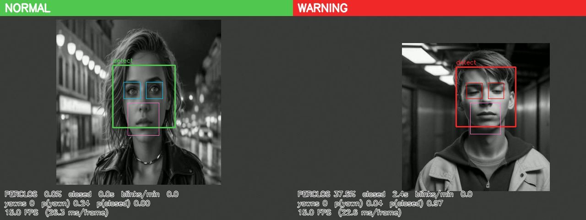
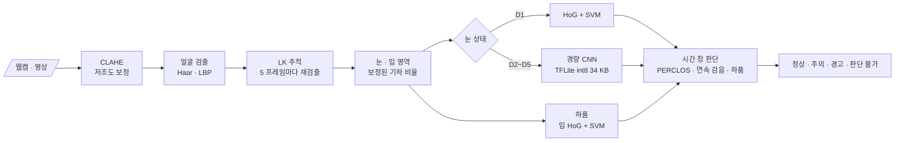

<div align="center">

# 😴 Driver Drowsiness Monitoring

**운전자 졸음 감지(DMS): 고전 검출기 + 경량 CNN + 시간축 판단**


> 웹캠 하나로 운전자의 눈 감김을 읽고, **잠깐 깜빡임과 졸음을 구분해** 경보를 띄웁니다.<br/>
> 최종안(D4)은 1스레드 CPU에서 **79 FPS** (목표 15 FPS).



</div>

---

## ⚡ 빠른 시작

```bash
uv venv .venv --python 3.10 && uv pip install --python .venv/bin/python -r requirements.txt
# (uv 가 없으면: python3.10 -m venv .venv && .venv/bin/pip install -r requirements.txt)

# 실행 — 학습된 모델(models/)이 저장소에 들어 있어 바로 돈다
.venv/bin/python -m src.app                          # 웹캠 0번 (q 로 종료)
.venv/bin/python -m src.app --source drive.mp4       # 영상 파일
.venv/bin/python -m src.app --preset D1 --no-display --log results/run.csv
```

- 화면 상단 띠: `NORMAL`(정상) · `CAUTION`(주의) · `WARNING`(경고, 터미널 벨) · `NO FACE`(판단 불가)
- 개인정보: 기본값으로 영상은 저장하지 않습니다. `--log` 는 숫자 판정만 기록하고, `--output` 은 시연 영상을 만들 때만 명시적으로 씁니다.
- WSL 에는 웹캠이 없으므로 영상 파일을 쓰거나 Windows 쪽 Python 에서 실행하세요.

### 처음부터 재현 (데이터 → 학습 → 평가)

```bash
python -m scripts.download_data          # cascade + 공개 데이터 일부 (~1 GB)
python -m scripts.prepare_data           # 눈 패치 12,000장 + 얼굴 검출 메타
python -m scripts.calibrate_geometry     # 얼굴 박스 → 눈 위치 비율
python -m src.classify.hog_svm           # D1 분류기
python -m src.classify.train_cnn         # 경량 CNN + TFLite fp32/fp16/int8
python -m experiments.eval_eye_state     # 1. 눈 상태
python -m experiments.eval_pipeline      # 2. 전체 파이프라인 D1~D5
python -m experiments.eval_yawn          # 3. 하품 (모델 학습 포함)
python -m experiments.eval_temporal      # 4. 시간 창 판단 · 임계값 선택
python -m experiments.benchmark_fps      # 5. 속도
python -m experiments.report             # → results/RESULTS.md
python -m pytest tests                   # 24개
```

모든 python 명령은 저장소 루트에서 `.venv/bin/python` 으로 실행합니다.

---

## 📌 문제 정의

졸음 감지의 어려움은 "눈을 감았는가"보다 **"얼마나 오래, 얼마나 자주 감았는가"**에 있습니다. 한 프레임 판정은 깜빡임, 안경 반사, 저조도 때문에 자주 틀립니다. 그래서 프레임 판정 위에 **시간 창(window) 기반 판단**을 둡니다.

## 🎯 목표와 결과

| # | 목표 | 성공 기준 | 결과 |
|:---:|---|---|---|
| G1 | 얼굴 → 눈 영역 → 눈 상태 파이프라인 | 눈 상태 F1 | CNN **F1 0.991** (패치), 0.985 (검출된 얼굴, D4) |
| G2 | PERCLOS · 연속 감음 · 하품 졸음 판정 | 이벤트 정밀도 · 재현율 | D4: 재현율 **0.80**, 정밀도 1.00, 시간당 오경보 0 (합성 세션) |
| G3 | 저조도 · 안경 조건 대응 | 조건별 성능 저하 폭 | 패치 F1 저하 −0.01 (저조도 · 반사), 종단(D4) −0.03. 병목은 **얼굴 검출** |
| G4 | CPU 실시간 | 15 FPS 이상 | D4 **79 FPS** (1스레드), 219 FPS (기본) |

세부 수치: [results/RESULTS.md](results/RESULTS.md)

---

## 🧭 파이프라인



### 경보 규칙 (`configs/default.yaml`)

| 신호 | 정의 | 경보 조건 |
|---|---|---|
| 연속 감음 | 감은 상태가 이어진 시간 (0.1초 이하의 '뜸' 오판정은 무시) | **1.5초 이상 → 경고** |
| PERCLOS | 최근 60초 유효 프레임 중 감은 프레임 비율 (유효 10초 이상일 때만) | 15% 이상 → 주의, **25% 이상 → 경고** |
| 하품 | 입 영역 하품 확률 ≥ 0.5 가 1초 이상 | 5분 안에 3회 이상 → 주의 |
| 판단 불가 | 얼굴/눈을 못 찾은 상태가 1초 이상 | 회색 표시. 단, 경고는 3초간 유지 |

연속 감음 1.5초와 PERCLOS 경고 25% 는 합성 검증 세션에서 16개 조합 중 고른 값입니다 (4절).

### 구성 (D1~D5, `--preset`)

| ID | 얼굴 검출 | 눈 상태 | 시간 판단 |
|:---:|---|---|---|
| D1 | Haar | HoG + SVM | 연속 감음만 |
| D2 | Haar | 경량 CNN | 연속 감음만 |
| D3 | Haar + LK | 경량 CNN | PERCLOS + 연속 감음 + 하품 |
| **D4 (기본)** | D3 + CLAHE | 경량 CNN | 〃 |
| D5 | LBP + LK + CLAHE | 경량 CNN | 〃 |

---

## 🔬 주요 결과

**1. 눈 상태 (정답 눈 위치 패치, 시험 1,200 패치)**

| 조건 | HoG+SVM F1 | CNN int8 F1 |
|---|---|---|
| 일반 | 0.989 | **0.991** |
| 저조도(합성) | 0.975 | **0.982** |
| 안경 반사(합성) | 0.934 | **0.979** |

CNN 은 int8 양자화(34 KB)에도 fp32 와 같은 정확도이고, 프레임당 0.3 ms 로 SVM(4.1 ms)보다 14배 빠릅니다.

**2. 전체 파이프라인 (정지 영상)** — 눈 상태는 잘 맞히지만 **얼굴을 못 찾는 것이 병목**입니다.

| 구성 | 일반: 얼굴 검출률 / F1 | 저조도: 얼굴 검출률 / F1 |
|---|---|---|
| D2 (Haar) | 80.3% / 0.979 | 69.2% / 0.968 |
| D4 (Haar + CLAHE) | 76.0% / 0.985 | **76.0%** / 0.958 |
| D5 (LBP + CLAHE) | 71.0% / 0.991 | 59.7% / 0.976 |

CLAHE 는 저조도 얼굴 검출을 +6.8%p 올리고 일반 조건에서는 −4.3%p 내립니다. 차 안 조도가 자주 바뀌는 점을 고려해 최종안(D4)에 넣었습니다.

**3. 하품** — 입 벌림 비율 규칙(README 초안)은 AUC 0.57 로 거의 무작위였습니다(수염 · 그림자 · 치아). 입 영역 **HoG + SVM 으로 바꿔 AUC 0.935, 정확도 85.6%**. 또 하품하는 얼굴은 Haar 검출률이 52% 로, 하품 아닌 얼굴(77%)보다 크게 낮습니다. LK 추적이 필요한 이유입니다.

**4. 시간 창 판단 (합성 운전 세션, 시험 결과)**

| 구성 | 재현율 | 정밀도 | 시간당 오경보 |
|---|---|---|---|
| D1 (SVM, 연속 감음만) | 0.642 | 0.989 | 0.12 |
| D2 (CNN, 연속 감음만) | 0.642 | 1.000 | 0.00 |
| **D4 (최종안)** | **0.802** | 1.000 | 0.00 |
| D4 저조도 / 반사 | 0.753 / 0.728 | 1.000 / 0.981 | 0.00 / 0.24 |

PERCLOS + LK 추적을 더하면 연속 감음만 볼 때보다 졸음 구간 재현율이 +16%p 오릅니다. '주의 이상'까지 세면 D3~D5 재현율은 0.99 입니다.

**5. 속도** (Intel Core Ultra 5 245KF, 640×480, 1스레드): D1 36 · D2 39 · D3 86 · **D4 79** · D5 120 FPS. LK 추적으로 검출을 5프레임에 1번만 하는 것이 가장 큰 가속 요인입니다(얼굴 단계 25 ms → 8 ms).

---

## 🛠️ 설계 결정 (데이터로 정한 것)

| 결정 | 근거 |
|---|---|
| 눈 패치 크기를 **양눈 거리(IOD) × 0.75** 로 | 정답 bbox 크기를 쓰면 감은/뜬 눈 bbox 크기 차이가 배율 단서로 새어 들어감. IOD 는 라벨과 무관 |
| 눈 위치는 **보정된 기하 비율** (Haar eye 보정은 옵션) | Haar eye cascade 는 감은 눈을 자주 놓침. 학습 분할에서 비율을 추정, 검증 오차 중앙값 0.075 IOD |
| 증강의 위치 흔들림 σ = 0.1 패치 | 위 기하 비율 오차 분포에 맞춤 |
| 데이터 분할은 **parquet 파일 단위** | 같은 프롬프트로 만든 비슷한 얼굴이 학습/시험에 섞이지 않게 |
| cascade `minNeighbors` 5 → 3 | 검증 분할 얼굴 검출률 +1.6%p, 저조도 +4%p, 속도 동일 |
| 하품: 비율 규칙 → HoG + SVM | 위 3번 결과 |
| CNN 은 TFLite int8 로 추론 | 정확도 동일, Keras 호출보다 프레임당 오버헤드가 훨씬 작음 |

---

## 🗂️ 데이터

| 데이터 | 용도 | 비고 |
|---|---|---|
| [MichalMlodawski/closed-open-eyes](https://huggingface.co/datasets/MichalMlodawski/closed-open-eyes) | 눈 상태 학습 · 평가, 얼굴 검출 · 기하 비율 | ODC-BY. **AI 생성** 얼굴 + 눈 bbox. 6,000장 사용 (70/15/15) |
| [c3rl/yawning-people](https://huggingface.co/datasets/c3rl/yawning-people) | 하품 학습 · 평가 | MIT. AI 생성. 2,513장 사용 |
| [CEW](https://parnec.nuaa.edu.cn/_upload/tpl/02/db/731/template731/pages/xtan/ClosedEyeDatabases.html) | (선택) 실제 사진 눈 상태 평가 | 공식 페이지가 자동 다운로드를 막아 **수동으로** 받아 `data/cew/` 에 풀면 `load_cew_patches` 로 읽힘 |
| NTHU-DDD | 실제 졸음 이벤트 평가 | 사용 신청 필요 → 아직 없음. 대신 합성 세션으로 평가 |

데이터(`data/`)는 저장소에 올리지 않습니다.

## ⚠️ 한계 (결과를 읽을 때)

- **학습 · 평가 얼굴이 AI 생성 이미지입니다.** 실제 운전석 카메라(측면 조명, 적외선, 해상도)에서는 수치가 낮아질 수 있습니다. 실제 사진인 CEW, 직접 녹화 영상으로 다시 확인해야 합니다.
- **저조도 · 안경 반사는 합성 조건입니다** (감마 · 이득 · 잡음, 눈 위 밝은 타원). 진짜 안경 · 적외선 조건은 직접 녹화 실험이 필요합니다.
- **졸음 이벤트 지표(G2)는 합성 세션 결과입니다.** 깜빡임 · 미세수면 · 하품 통계와 '졸음 아닌 긴 감음'(재채기 등) 빈도는 가정값이고, 프레임 오류만 실측값입니다. 경고까지 걸린 시간 중앙값(~20초)도 가정한 미세수면 빈도에 따라 정해집니다.
- 고개를 크게 돌리거나 숙이면 정면 cascade 가 실패합니다. LK 추적은 최대 2초까지만 버티고, 그 뒤에는 '판단 불가'로 표시합니다.

## 🔜 다음 단계

1. NTHU-DDD 사용 신청 → 실제 졸음 이벤트로 G2 재평가, 임계값 재선택
2. 본인 영상 녹화 (주간 / 야간 / 안경) → 조건별 실제 성능 (원본 영상은 저장소에 올리지 않음)
3. CEW 수동 다운로드 → 실제 사진 눈 상태 F1
4. 얼굴 검출 병목: 측면 얼굴 cascade 추가 또는 경량 DNN 검출기와 비교

---

## 📁 디렉토리 구조

```
Driver-Drowsiness-Monitoring/
├── configs/default.yaml     최종안(D4) 설정 · 경보 임계값
├── models/                  cascade, 기하 비율, eye_cnn_*.tflite, eye_svm, yawn_svm
├── scripts/                 download_data · prepare_data · calibrate_geometry
├── src/
│   ├── detect/              face.py · tracker.py · eye_mouth.py
│   ├── classify/            hog_svm.py · cnn.py · train_cnn.py · yawn_svm.py · augment.py · datasets.py
│   ├── temporal/            perclos.py · alert.py
│   ├── config.py            설정 · D1~D5 프리셋
│   ├── pipeline.py          프레임 처리 · 화면 표시
│   └── app.py               웹캠 / 영상 실행
├── experiments/             eval_eye_state · eval_pipeline · eval_yawn · eval_temporal · benchmark_fps · report
├── results/                 실험 결과 JSON · RESULTS.md · 시연 이미지
└── tests/                   pytest 24개
```

---

## 🔗 기반 수업과 저장소

| 수업 / 프로젝트 | 가져온 것 | 저장소 |
|---|---|---|
| 산업 컴퓨터비전 Lec 12 | Viola-Jones(Haar) · LBP 얼굴 검출, HoG, SVM | [industrial_computor_vision](https://github.com/cbnu-yhjeon/industrial_computor_vision) |
| 산업 컴퓨터비전 Lec 3 · 9 | CLAHE(저조도 보정), LK 추적 | 〃 |
| 손글씨 인식 | 작은 CNN 설계 · 학습, 전처리 → 추론 CLI 구조 | [PROJECT-Handwriting-recognition-programs](https://github.com/cbnu-yhjeon/PROJECT-Handwriting-recognition-programs) |
| 견종 인식 | 전이학습 경험 (이 과제는 입력이 32×32 라 작은 CNN 을 처음부터 학습) | [PROJECT-Breed-Recognition-Program](https://github.com/cbnu-yhjeon/PROJECT-Breed-Recognition-Program) |
| 패턴인식 · 딥러닝 실체 | 분류기 설계, CNN 원리 | [Pattern_Rcognition](https://github.com/cbnu-yhjeon/Pattern_Rcognition) · [Deep-Learning-Entities](https://github.com/cbnu-yhjeon/Deep-Learning-Entities) |

## 📚 참고 자료

- P. Viola, M. Jones, *Rapid Object Detection using a Boosted Cascade of Simple Features*, CVPR 2001
- F. Song et al., *Eyes Closeness Detection from Still Images with Multi-scale Histograms of Principal Oriented Gradients*, Pattern Recognition 2014 (CEW)
- W. W. Wierwille et al., *Research on Vehicle-Based Driver Status/Performance Monitoring* (PERCLOS), NHTSA 1994
- 산업 컴퓨터비전 Lec 3 · 9 · 12 강의 자료
