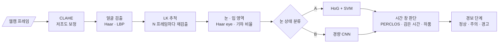

<div align="center">

# 😴 Driver Drowsiness Monitoring

**운전자 졸음 감지(DMS): 고전 검출기 + 경량 CNN + 시간축 판단**


> 웹캠 하나로 운전자의 눈 감김을 읽고, **잠깐 깜빡임과 졸음을 구분해** 경보를 띄웁니다.<br/>
> CPU에서 실시간으로 도는 것을 목표로 합니다.

</div>

> [!NOTE]
> 🚧 **계획 단계입니다.** 아직 코드가 없고, 이 README는 프로젝트 설계서입니다.

---

## 📌 문제 정의

졸음 감지의 어려움은 "눈을 감았는가"보다 **"얼마나 오래, 얼마나 자주 감았는가"**에 있습니다. 한 프레임 판정은 깜빡임, 안경 반사, 저조도 때문에 자주 틀립니다. 그래서 프레임 판정 위에 **시간 창(window) 기반 판단**이 필요합니다.

## 🎯 목표

| # | 목표 | 성공 기준 |
|:---:|---|---|
| G1 | 얼굴 → 눈 영역 → 눈 상태(뜸/감음) 파이프라인 | 눈 상태 F1 측정 |
| G2 | PERCLOS · 눈 감은 시간 · 하품 기반 졸음 판정 | 졸음 이벤트 정밀도 · 재현율 |
| G3 | 저조도 · 안경 조건 대응 | 조건별 성능 저하 폭 측정 |
| G4 | CPU 실시간 | 노트북 CPU에서 15 FPS 이상 (목표) |

---

## 🔗 기반 수업과 저장소

| 수업 / 프로젝트 | 가져올 것 | 저장소 |
|---|---|---|
| 산업 컴퓨터비전 Lec 12 | Viola-Jones(Haar) · LBP 얼굴 검출, HoG, SVM | [industrial_computor_vision](https://github.com/cbnu-yhjeon/industrial_computor_vision) (`Data/`의 cascade 파일 포함) |
| 산업 컴퓨터비전 Lec 3 · 9 | CLAHE(저조도 보정), LK 추적(검출 사이 얼굴 위치 유지) | 〃 |
| 손글씨 인식 | 작은 CNN 설계·학습, 입력 전처리 → 추론 CLI 구조 | [PROJECT-Handwriting-recognition-programs](https://github.com/cbnu-yhjeon/PROJECT-Handwriting-recognition-programs) |
| 견종 인식 | MobileNetV2 전이학습 | [PROJECT-Breed-Recognition-Program](https://github.com/cbnu-yhjeon/PROJECT-Breed-Recognition-Program) |
| 패턴인식 · 딥러닝 실체 | 분류기 설계, CNN 원리 | [Pattern_Rcognition](https://github.com/cbnu-yhjeon/Pattern_Rcognition) · [Deep-Learning-Entities](https://github.com/cbnu-yhjeon/Deep-Learning-Entities) |

---

## 🧭 접근 방법



### 시간축 판단 (초안 기준)

| 신호 | 정의 | 경보 조건 (초안) |
|---|---|---|
| PERCLOS | 최근 60초 중 눈을 감은 프레임 비율 | 15% 이상 → 주의, 30% 이상 → 경고 |
| 연속 감음 | 한 번 눈을 감은 상태로 이어진 시간 | 1.5초 이상 → 경고 (깜빡임은 보통 0.1~0.4초) |
| 하품 | 입 영역 세로/가로 비율이 일정 시간 이상 큼 | 5분 안에 3회 이상 → 주의 |

임계값은 검증 데이터로 다시 정합니다.

---

## 🗂️ 데이터

| 데이터 | 용도 | 비고 |
|---|---|---|
| [CEW (Closed Eyes In The Wild)](https://parnec.nuaa.edu.cn/_upload/tpl/02/db/731/template731/pages/xtan/ClosedEyeDatabases.html) | 눈 상태 분류 학습 · 평가 | 뜬 눈 / 감은 눈 영상 |
| NTHU-DDD (Driver Drowsiness Detection) | 졸음 이벤트 평가 | 사용 신청 필요 |
| 직접 녹화 영상 | 저조도 · 안경 조건 시험 | 본인 영상만 사용, 원본은 저장소에 올리지 않음 |

---

## 🧪 실험 설계

| ID | 얼굴 검출 | 눈 상태 | 시간 판단 | 목적 |
|:---:|---|---|---|---|
| D1 | Haar | HoG + SVM | 연속 감음만 | 고전 기준선 |
| D2 | Haar | 경량 CNN | 연속 감음만 | CNN 효과 |
| D3 | Haar + LK | 경량 CNN | PERCLOS + 연속 감음 + 하품 | 최종안 |
| D4 | D3 + CLAHE | 경량 CNN | 〃 | 저조도 보완 |
| D5 | LBP | 경량 CNN | 〃 | 검출기 속도 · 정확도 비교 |

### 지표

- **눈 상태:** 정확도, F1 (CEW)
- **졸음 이벤트:** 정밀도 · 재현율, **시간당 오경보 수**
- **조건별:** 주간 / 저조도 / 안경 착용별 성능
- **속도:** CPU FPS, 프레임당 단계별 소요 시간

---

## 🗓️ 마일스톤

| 주차 | 내용 | 산출물 |
|:---:|---|---|
| 1 | 얼굴 · 눈 검출, LK 추적 | 실시간 데모 v0 |
| 2 | HoG + SVM 눈 상태 분류 (D1) | CEW 결과 |
| 3 | 경량 CNN (D2), 모델 경량화 | CNN 결과, 속도 비교 |
| 4 | 시간 창 판단 (D3) | 경보 로직 |
| 5 | 저조도 · 안경 시험, D4 · D5 | 조건별 결과 |
| 6 | 정리, 시연 영상 | 최종 보고서 |

## 📁 디렉토리 구조 (계획)

```
Driver-Drowsiness-Monitoring/
├── models/             cascade 파일, 학습된 CNN · SVM
├── src/
│   ├── detect/         face.py · eye_mouth.py · tracker.py
│   ├── classify/       hog_svm.py · cnn.py · train_cnn.py
│   ├── temporal/       perclos.py · alert.py
│   └── app.py          웹캠 실시간 실행
├── results/
└── README.md
```

## ⚠️ 리스크와 대응

| 리스크 | 대응 |
|---|---|
| 고개를 돌리면 Haar 정면 검출이 실패 | LK 추적으로 위치 유지, 실패가 이어지면 "판단 불가" 상태로 표시 |
| 안경 반사로 눈 영역이 하얗게 날아감 | 조건별로 분리 평가, 필요하면 적외선 웹캠 실험 |
| 개인정보 | 얼굴 영상은 저장하지 않고 판정 결과만 기록, 공개 데이터는 라이선스 준수 |

## 📚 참고 자료

- P. Viola, M. Jones, *Rapid Object Detection using a Boosted Cascade of Simple Features*, CVPR 2001
- F. Song et al., *Eyes Closeness Detection from Still Images with Multi-scale Histograms of Principal Oriented Gradients*, Pattern Recognition 2014 (CEW)
- W. W. Wierwille et al., *Research on Vehicle-Based Driver Status/Performance Monitoring* (PERCLOS), NHTSA 1994
- 산업 컴퓨터비전 Lec 3 · 9 · 12 강의 자료
